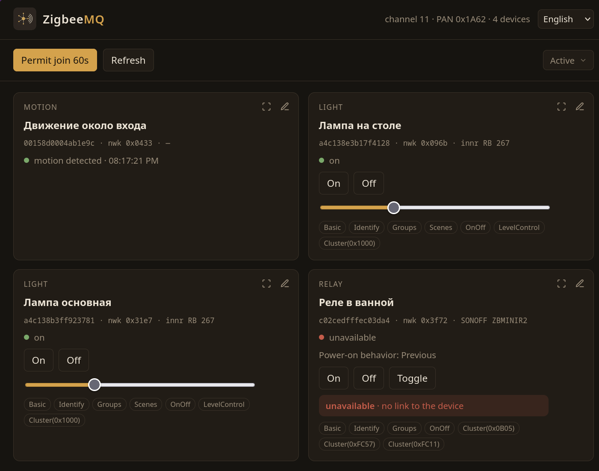

# zigbeemq

Zigbee → HTTP + MQTT bridge in Go. A zigbee2mqtt-style bridge, not a z2m clone: one binary, a simple UI, and topics compatible with `zigbee2mqtt/<name>`.

Target host is OpenWrt. The stick runs on `router`.



## Hardware and network

- Stick: Sonoff Zigbee 3.0 USB Dongle Plus (CC2652, Z-Stack / ZNP), usually `/dev/ttyUSB0`
- Stack: [goznp](https://github.com/marstid/goznp)
- MQTT: Mosquitto on host `bb`, `tcp://bb:1883`
- Coordinator is **already formed** (channel 11). Do not reform the network.

While this process holds the stick, zigbee2mqtt must not use the same serial port.

## Build and run

Requires Go 1.22+ (`go.mod` pins 1.27.1).

```bash
go build -o zigbeemq ./cmd/zigbeemq

./zigbeemq \
  -port /dev/ttyUSB0 \
  -listen 127.0.0.1:8088 \
  -data ./data \
  -mqtt tcp://bb:1883
```

UI: <http://127.0.0.1:8088/>

### OpenWrt

Cross-build linux/arm64 and install over SSH (`Host router` in `~/.ssh/config`):

```bash
./scripts/deploy-openwrt.sh
```

On the router: `/usr/sbin/zigbeemq`, init `/etc/init.d/zigbeemq`, config `/etc/config/zigbeemq`, data `/etc/zigbeemq`. HTTP listens on `0.0.0.0:8080`. Stick driver: `kmod-usb-serial-cp210x`. Open the UI on the router LAN address (port 8080).

After edits under `internal/web/static/`, rebuild: the page is embedded with `go:embed`. If the HTML did not update, use `go build -a`.

### Flags and environment

| Flag | Env | Default |
|------|-----|---------|
| `-port` | `GOZNP_PORT` | `/dev/ttyUSB0` |
| `-listen` | `ZIGBEEMQ_LISTEN` | `:8080` |
| `-data` | `ZIGBEEMQ_DATA` | `./data` |
| `-mqtt` | `ZIGBEEMQ_MQTT` | `tcp://bb:1883` (`-` or empty disables MQTT) |
| `-mqtt-base` | `ZIGBEEMQ_MQTT_BASE` | `zigbee2mqtt` |

## Features

- Device list from the coordinator table; optional name hints in `internal/hub/known.go` and labels in the disk cache
- Cards: on/off, brightness, button clicks, motion occupancy
- SONOFF ZBMINIR2 (`ZBMINIR2`, white-label `MINI-ZBD`) is kind `relay`, separate from a plain OnOff `plug`. The edit dialog stores power-on behavior, network LED, radio power, detach, external trigger, and delayed power-on. Inching is a separate one-shot pulse.
- Permit join, interview, rename, kind, archive / restore, remove from network
- Main list filter: Active (default) / Archived / All (browser `localStorage`)
- Unknown devices get a generic card; cluster snapshot after interview
- MQTT: `zigbee2mqtt/<name>` (retain), `…/set`, `…/action` for buttons, `bridge/state`

Interview and label cache: `data/devices.json` (directory is gitignored). Archive is a UI flag in that cache (`archived`); the device stays on the Zigbee network. Old caches without the field load as active — no migration.

## HTTP API

| Method | Path |
|--------|------|
| `GET` | `/api/network` |
| `GET` | `/api/devices` |
| `GET` | `/api/events` (SSE) |
| `POST` | `/api/refresh` |
| `POST` | `/api/permit-join` `{"seconds":60}` |
| `POST` | `/api/devices/{ieee}/on` |
| `POST` | `/api/devices/{ieee}/off` |
| `POST` | `/api/devices/{ieee}/brightness` `{"percent":0-100}` |
| `POST` | `/api/devices/{ieee}/toggle` |
| `GET` | `/api/devices/{ieee}/relay` |
| `PATCH` | `/api/devices/{ieee}/relay` |
| `POST` | `/api/devices/{ieee}/interview` |
| `PATCH` | `/api/devices/{ieee}` `{"name","kind","archived"}` |
| `DELETE` | `/api/devices/{ieee}` |

`kind`: `light`, `plug`, `relay`, `switch`, `sensor`, `motion`, `unknown`. `relay` is the ZBMINIR2 only. `archived` is optional (`true`/`false`); omit to leave unchanged.

`PATCH /api/devices/{ieee}/relay` accepts any subset of `power_on_behavior` (`off`/`on`/`toggle`/`previous`), `network_indicator`, `turbo_mode`, `detach_relay_mode`, `external_trigger_mode` (`edge`/`pulse`/`following(off)`/`following(on)`), `delayed_power_on_state`, `delayed_power_on_time` (seconds, 0.5–3599.5, step 0.5), and one-shot `inching_control_set`. Omitted fields stay as they are.

A sleeping sensor will not answer interview until woken. Unavailable devices (no ACK, `0xB7` / `0xCD`) show as unavailable on the card, without raw Z-Stack status. UI language defaults to English; Russian and German are selectable (stored in the browser).

## MQTT

Published like zigbee2mqtt:

- `zigbee2mqtt/<name>` — `state`, `brightness`, `action`, `occupancy`, and for a relay the same keys as `GET …/relay`
- `zigbee2mqtt/<name>/set` — `ON`/`OFF`/`TOGGLE` or JSON. `TOGGLE` on a ZBMINIR2 is a ZCL toggle. A JSON body may also carry the relay patch, including `inching_control_set`.
- `zigbee2mqtt/<name>/action` — click pulse
- `zigbee2mqtt/bridge/state` — `online`/`offline` (retain + will)

## Layout

```
cmd/zigbeemq/     entrypoint
internal/hub/     coordinator, devices, clicks / motion
internal/web/     HTTP + embedded UI
internal/mq/      MQTT bridge
```

UI is a single `index.html` with no framework.

## Important

Do not call FormNetwork or factory-reset the stick: that wipes the Zigbee network. Do not send on/off to lamps unless explicitly asked — that is live lighting.
